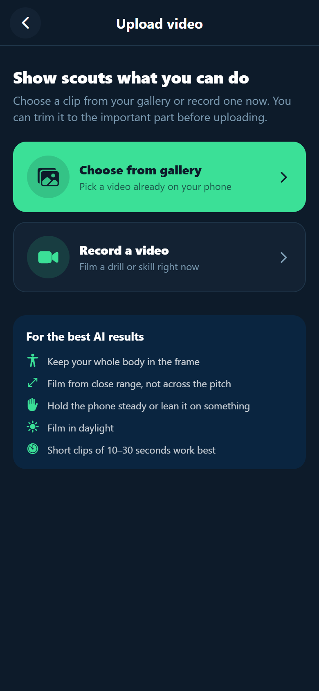
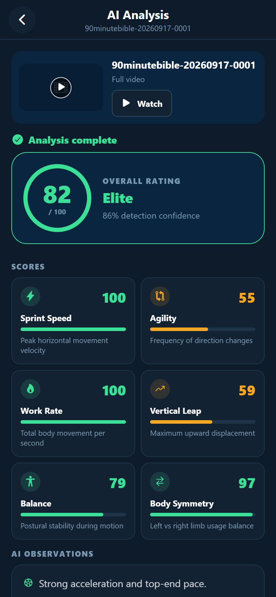
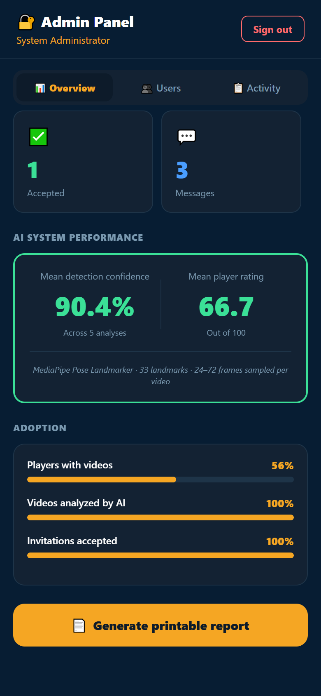

# Talanta

**AI-powered sports video analysis to help scouts discover grassroots football talent in Kenya.**

Players upload short highlight clips from their phone. Talanta analyses each clip on the device with Google MediaPipe pose estimation, turns the movement into an objective performance rating, and makes the player searchable by scouts, who can shortlist players, send trial invitations, and message them directly.

Built as a final-year BSc Computer Science project at UMMA University.

<p align="center">
  
  
  
  
</p>

## Features

**Players**
- Register with a 6-digit email verification code
- Upload highlight videos from the gallery or camera, with automatic compression to 720p and live upload progress
- Trim a clip to the section the AI should analyse
- Full-screen video player with seeking, playback speed and landscape mode
- AI report with six metrics (sprint speed, agility, work rate, vertical leap, balance, body symmetry), an overall rating and a detection confidence
- Respond to trial invitations and message scouts

**Scouts**
- Search and filter players by position, county and AI rating
- View player profiles and AI scouting reports
- Shortlist players and send trial invitations

**Administrator**
- Platform totals, engagement figures and AI system performance
- Printable system report

## How the AI works

1. The clip is downloaded once and sampled at 5 frames per second inside the selected section (24–72 frames).
2. Each frame is resized to 480 px and passed to **MediaPipe Pose Landmarker**, which detects 33 body landmarks.
3. The landmark movement is converted into six scores, a weighted overall rating, and approximate distance, top speed and jump height.
4. Analysis runs on the phone in a background WebView, so it continues while the user moves between screens and needs no paid AI server.

Analysing a 19-second clip took 135.8 s with the first version of the engine, and 27.2 s after optimisation (12.3 s on a repeat run).

## Tech stack

| Layer | Technology |
|---|---|
| Mobile app | React Native 0.81, Expo SDK 54, Expo Router, TypeScript |
| AI | Google MediaPipe Pose Landmarker (tasks-vision) in a WebView |
| Backend | Supabase: Auth, PostgreSQL with Row Level Security, Storage |
| Video | expo-image-picker, react-native-compressor, expo-video, expo-video-thumbnails |
| Builds | EAS Build (Android APK) |

## Project structure

```
app/          Screens (file-based routing with Expo Router)
components/   Reusable UI and video components (player, trim editor, cards, skeletons)
lib/          Supabase client, upload pipeline, AI engine, error handling
supabase/     Database migrations (schema changes and security policies)
```

## Getting started

```bash
npm install
npx expo start
```

The app connects to a Supabase project configured in `lib/supabase.ts`. To build an installable Android APK:

```bash
npx eas-cli build -p android --profile preview
```

## Security

Every table uses Supabase Row Level Security: users can read and change only their own data, messages are visible only to the sender and receiver, and administrators are verified against the `admins` table. The policies are in [`supabase/migrations`](supabase/migrations).

## Author

**Abdul Isaak Bika** · BSc Computer Science, UMMA University, Kenya
